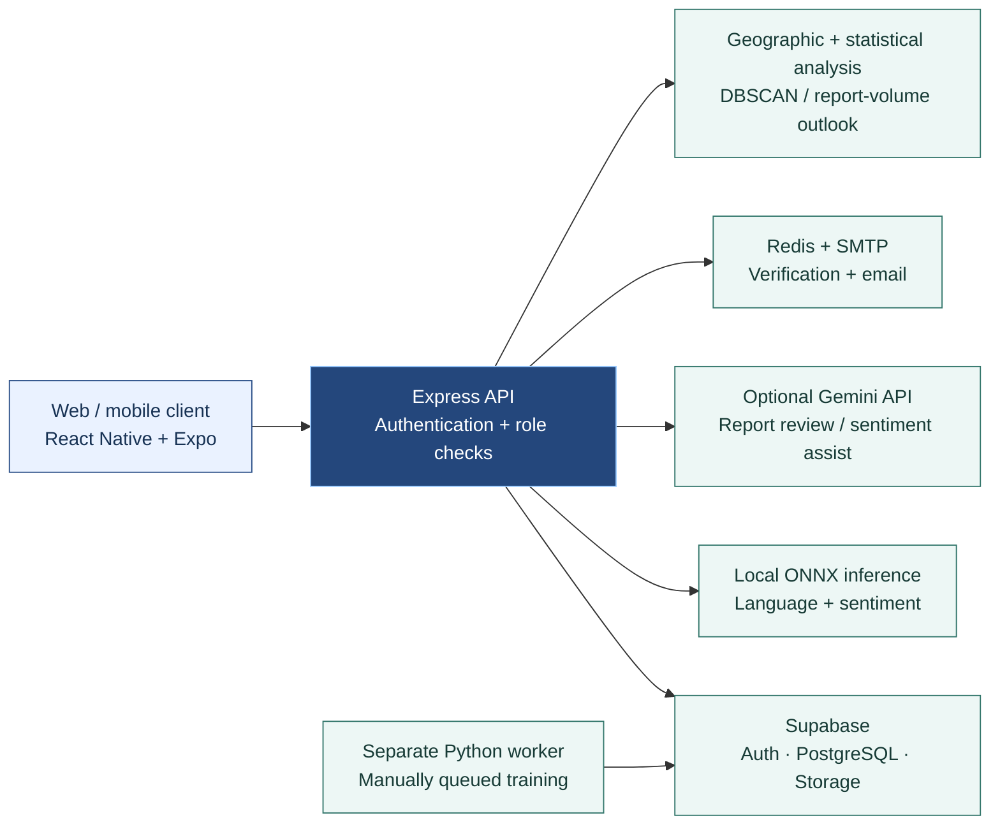
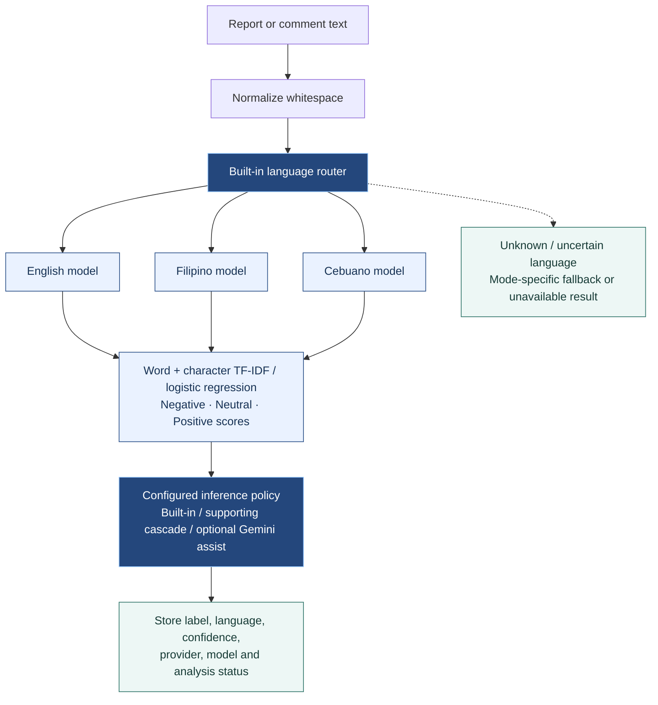
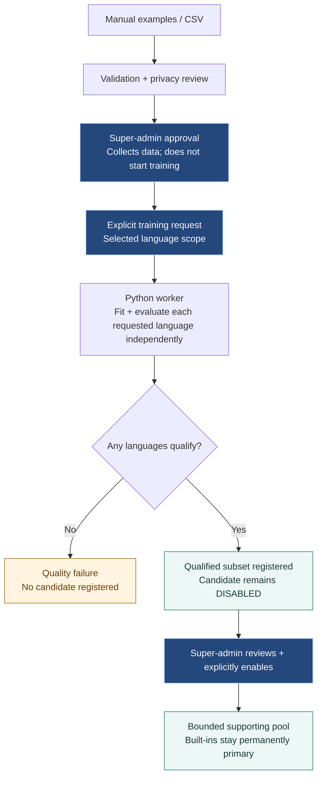

<div align="center">

# CommuniShield

**A community incident-reporting and public-safety awareness prototype for Argao, Cebu.**

<p>
  
  
  
  
  
  
</p>

**Cebuano · English · Filipino** &nbsp; | &nbsp; **Web + mobile** &nbsp; | &nbsp; **Human-reviewed reports**

<p>
  <a href="#overview">About the system</a> ·
  <a href="#installation">Get started</a> ·
  <a href="#features">Explore features</a> ·
  <a href="#ai-models">Understand the AI</a> ·
  <a href="#workers">Run the worker</a> ·
  <a href="#tests">Development checks</a>
</p>

</div>

---

<details>
<summary><strong>Navigate this guide</strong></summary>

1. [System overview](#overview)
2. [Main features](#features)
3. [Architecture and report flow](#architecture)
4. [How the AI and models work](#ai-models)
5. [Sentiment training](#training)
6. [Geographic clustering and seven-day outlook](#geography)
7. [Data Privacy Act, security and operational limits](#security)
8. [Installation and setup](#installation)
9. [Run and troubleshoot workers](#workers)
10. [Tests and development checks](#tests)
11. [Repository guide](#repository)

</details>

<a id="overview"></a>

## 1. What is CommuniShield?

CommuniShield is a cross-platform community incident-reporting and public-safety
awareness system focused on **Argao, Cebu**. Residents can submit reports, attach
photos, discuss updates and view mapped community information. Administrators
review submissions, manage incident records and inspect descriptive analytics.
Super-admins additionally manage privileged accounts, system configuration and
the reviewed sentiment-training workflow.

The system combines human moderation with multilingual text classification,
cloud-assisted report review, geographic clustering and statistical reporting
outlooks. These components answer **different questions**; they do not combine
into a scientifically validated danger score.

> [!CAUTION]
> CommuniShield is a prototype decision-support system, not an emergency dispatch
> service, a verified crime database, or a guarantee that an area is safe. For an
> emergency, contact the appropriate emergency service directly.

<a id="features"></a>

## 2. Main features

| Residents | Administrators | Super-admins |
| :--- | :--- | :--- |
| **Report & participate** — submit incidents, attach photos and discuss updates. | **Review & manage** — moderate reports, inspect maps and track report history. | **Govern & configure** — manage privileged accounts, settings and reviewed training. |
| **Stay informed** — explore nearby reports, notifications and safety tips. | **Understand patterns** — inspect analytics, spatial concentrations and submission outlooks. | **Control candidates** — approve data, queue training and manually enable qualified supports. |

### Resident features

- Account registration, password recovery and email/device sign-in verification.
- Incident submission with category, type, narrative, location and photo uploads.
- Personal report tracking and permitted report editing.
- Community feed, report discussions/comments and likes.
- Interactive incident map with Argao barangay boundaries and location hierarchy.
- Notifications, nearby-report safety tips and emergency-facility information.
- Profile settings and separate notification/crime-alert preferences.

### Administrative features

- Dashboard and incident/category analytics.
- Review, verify, reject, resolve and manage reports through authorized actions.
- Report management with filtering, export and archived-report access through logs.
- Incident mapping and DBSCAN hotspot detection with sentiment/verification context.
- Current report-concentration indicators and a separate seven-day submission outlook.
- Announcements, administrative notifications, audit history and settings.
- Super-admin account management and sentiment dataset/candidate lifecycle controls.

Recent workflow details:

- **Verified** means confirmed but unresolved; **Resolved** means addressed. Both
  are verified states, and resolving an already verified report must not award
  verification points twice.
- Report Management orders incidents by review status, then severity, then oldest
  first before pagination/export. Record Management handles the separate records
  view; Logs retains chronological history.
- Dashboard and Incident Mapping date choices include All dates, Today, Past 7
  days and Past 30 days. Today uses Argao's UTC+8 calendar boundary.
- Risk Forecast is an experimental submission-volume summary, with expected
  next-seven-day reports, a rounded daily average and actual recent report count.
- AI settings save asynchronously with immediate feedback, rollback on failure
  and a success banner. AI Credibility Analysis controls **both** new scores and
  written reviews, independently of sentiment and manual verification.
- The Super Admin dashboard shows saved AI/sentiment controls; its fixed
  `CommuniShield-AI v1.0` display is not the database/provider model version.
- Disable, Activate and Delete require account-specific confirmation. Edit
  requests cannot be saved unchanged, including after reverting a field.
- Web PDF exports for Admin and Super Admin use the browser print/Save as PDF
  dialog without opening another tab; native uses PDF generation and sharing.

See [Super Admin settings](docs/super-admin-settings.md) and
[report ordering](DB_Schema/migrations/report_management_order.md).

Permissions are enforced by backend role checks and database policies, not only
by hiding buttons. Dataset inspection/submission and super-admin approval,
training and enabling are separate operations.

---

<a id="architecture"></a>

## 3. Architecture and report flow



| Layer | Implementation |
| --- | --- |
| Client | React Native, Expo, Expo Router, web/native map components and Axios. |
| API | Node.js, Express and TypeScript; local entry point `server/app.ts`, hosted API entry `server/api/index.ts`. |
| Persistence | Supabase PostgreSQL, Auth and Storage. |
| Verification/email | Upstash Redis REST and SMTP via Nodemailer. |
| Local model inference | ONNX Runtime in the backend. |
| Cloud AI | Gemini API, where configured and enabled. |
| Offline training | Python, scikit-learn, pandas, NumPy, joblib and ONNX export tools. |

Typical report flow:

1. The authenticated user completes a report and uploads any photos.
2. The API validates and persists the report and photo links before acknowledging
   success. A failed write must not appear as a successful submission.
3. Tracked background work handles submission credibility points, notifications,
   AI-assisted report review and sentiment analysis. Independent work is not
   blocked by one failed AI component.
4. The client can display the saved report while analysis is still pending.
5. Administrators inspect the report, available analysis and subsequent updates,
   then take an authorized moderation action.

Saving a report is **not** proof that AI analysis succeeded or that its contents
are verified. Analysis failures and insufficient-data states must remain visible.

<a id="ai-models"></a>

## 4. How the AI and models work

> [!TIP]
> **Faster startup and browser refresh:** dashboards load a small count-only
> overview first and fetch details in the background. Retained data is scoped to
> the signed-in session, and failed refreshes do not silently become zero counts.
> See [admin fetching](docs/admin-fetch-performance.md) and
> [background analysis](docs/admin-analysis-responsiveness.md).

| Component | Question it addresses | What it does **not** establish |
| :--- | :--- | :--- |
| **Sentiment** | What tone does the text express? | Whether the report is true or dangerous. |
| **AI-assisted review** | What details and potential severity deserve review? | Verified facts or a final moderation decision. |
| **DBSCAN** | Where are eligible active report locations concentrated? | A future crime event or danger probability. |
| **Seven-day outlook** | How many reports might be submitted? | Actual crime rates or individual safety. |

### A. Language identification and built-in sentiment

The built-in language router identifies **Cebuano, English or Filipino**. It uses
a trained word/character TF-IDF and logistic-regression pipeline exported to
`language_id.onnx`. Blank, uncertain or failed routing can return `unknown`.

For a supported language, its corresponding built-in sentiment model processes
the text:



TF-IDF represents informative words and character sequences numerically;
logistic regression learns associations with reviewed sentiment labels. These
are lightweight classifiers, not conversational LLMs. ONNX packages the pipeline
for inference without a Python service.

The wider service also supports `mixed` and `unclear` outcomes through cloud
analysis or abstention. A three-class local classifier does not independently
learn a fourth `mixed` class. Short words, sarcasm, negation and code-switching
can be difficult; confidence is a model score, **not a calibrated guarantee of
correctness**.

The built-in models and language router remain permanently primary. Uploaded
examples, candidate training and candidate enabling do not overwrite them.

### B. Optional supporting sentiment candidates

Supporting candidates are separately trained and independently evaluated helpers.
Only enabled, validated candidates qualified for the matching language may
contribute. Built-in fingerprints, artifact checks and training admission gates
remain enforced. They do not replace the permanent built-in files.

Serving uses the current **raw-confidence winner policy**, not the older
uncertainty cascade:

- Predictions below **0.45** are ineligible.
- The highest eligible raw confidence wins across available built-in, supporting
  and enabled Gemini predictions, even if their labels disagree.
- **0.85** separates the displayed high/moderate bands; it is not a second gate.
- Exact top ties with conflicting labels, or no eligible predictions, return
  `unclear`. There is **no averaging or majority voting**.

See [the current routing policy](server/SENTIMENT_RAW_CONFIDENCE.md). Raw scores
from different providers are not calibrated guarantees of correctness.

The enabled pool is bounded to **1–3 candidate bundles**. Candidates have manual
enable/disable/archive/restore/delete controls, subject to permissions and
history-preservation rules. Artifact manifests, checksums, built-in fingerprints
and protocol checks protect model loading and publication.

Supporting inference requires both backend flags:

```dotenv
SENTIMENT_MODEL_REGISTRY_ENABLED=true
SENTIMENT_SUPPORT_ENABLED=true
```

Set them only after the complete current schema/protocol is installed. They do
not train, qualify or enable candidates by themselves. With no qualified enabled
candidates, the built-in remains available.

### C. Optional Gemini sentiment assistance

Outside supporting-pool mode, settings can enable Gemini sentiment assistance.
The prompt classifies tone, allows `mixed`/`unclear`, and can include a parent
report's context for a comment. It explicitly separates sentiment from severity
and credibility.

Available Gemini output participates in the same raw-confidence policy described
above. Disabled or failed providers contribute no candidate; an available source
can win on its own. Existing saved analyses are not automatically regenerated
when a setting changes.

Cebuano Handling selects Local, Gemini only or Disabled. Turning Gemini off does
not silently change the saved Cebuano mode; Gemini-only Cebuano is unavailable
until Gemini is enabled or that mode is explicitly changed. Comments are judged
primarily by their own text, with parent context used to interpret the reply,
not automatically inherit the parent's sentiment.

### D. Gemini-assisted report review and severity

Report review is a separate service from sentiment. It sends incident details,
location and available contextual counts to Gemini and requests structured JSON:

- An AI report-assessment score from 0 to 100.
- A proposed severity: `Low`, `Medium`, `High` or `Critical`.
- A written explanation specific to the report.

The service loads configured model settings, can discover available model names,
and handles model failures/rate limits. No particular Gemini version is guaranteed
to be available for every API account. Successful analyses retain the model
version and analysis timing.

The pipeline also attempts image-metadata checks for missing metadata,
location/time inconsistencies and editing indicators; flags can reduce the
assessment score. **Metadata heuristics do not authenticate a photo or prove a
report false.** Missing metadata can have innocent causes, and these checks are
not a forensic computer-vision model.

AI review is advisory: it does not establish that an event happened, identify an
offender, or replace administrator verification. Cloud outages must not be
reported as successful analysis.

### E. User credibility is separate

User credibility is an application-managed, bounded points system, not a trained
AI model. Submission and moderation events can add or subtract points, with an
event history. It is distinct from a report's Gemini assessment score, its
severity, and the emotional tone of its text. None is a substitute for evidence.

---

<a id="training"></a>

## 5. How sentiment training works



CSV uploads use `text,language,label`. Languages are `cebuano`, `english` and
`filipino`; training labels are `negative`, `neutral` and `positive`. One-row and
single-word submissions are allowed, but low-context examples need careful human
review, not automatic labels.

Any one language, any pair, or all three can be requested. Scope comes from
declared reviewed row languages, **not automatic language detection**. Dataset
checkboxes select the run's language scope, not model activation or an exclusive
training corpus. Within those languages, baseline training rows and prior approved
examples remain available. Without selection, new approved versions determine
scope; a deliberate retry without new approvals retains the last recorded scope.

Two fitting modes are available:

- **Continued/warm-start:** reuse trusted existing weights and fixed vocabulary,
  adding approved examples with replay data.
- **Fresh challenger:** learn vocabulary and weights from baseline training data
  plus approved additions for the requested languages.

Each requested language is fitted/evaluated independently. An ordinary quality
failure in Filipino, for example, does not discard a passing Cebuano candidate.
Failed languages have no serving artifacts/policy; unrequested languages are
shown as **Not included**. Unexpected crashes, stale worker leases and invalid
artifacts still fail closed.

Current independent qualification gates include:

| Check, per language | Minimum |
| --- | --- |
| Validation and test macro-F1 | 0.60 |
| Every class's precision and recall on both splits | 0.50 |
| Held-out examples per class on each split | 10 |
| Accepted validation predictions | 20 |
| Accepted test predictions | 10 |
| Precision among accepted predictions on both splits | 0.75 |

Validation acceptance-threshold selection additionally requires a **Wilson 95%
lower precision bound of at least 0.75**. Test requirements are not weakened to
rescue a candidate. Qualification is independent: a candidate need not outperform
the built-in, but it must pass the absolute quality gates.

Approval does not start training; qualification does not automatically enable a
model. A small upload can accumulate toward later training and is **not** a
promise that the next run will pass. Human label quality and honest held-out
evaluation matter more than merely increasing row counts. Keep test material out
of uploads and do not repeatedly tune against final test outcomes.

See the [training workflow](server/SENTIMENT_LANGUAGE_SCOPED_TRAINING.md),
[admission rules](server/SENTIMENT_INDEPENDENT_ADMISSION.md), and
[training repairs and validation](datasets/TRAINING_REPAIRS.md).

<a id="geography"></a>

## 6. Geographic clustering and the seven-day outlook

### Hotspot detection: observed spatial concentrations

The backend runs **DBSCAN** on eligible active report locations within the bundled
Argao boundaries. Defaults are a trailing **30-day** window, a **300-metre**
neighborhood and **4 distinct locations** for density support, including the
location itself. Date/category/type filters apply before clustering.

Identical coordinate pairs count as **one spatial location**, while retaining
their original report IDs/counts. Repeated posts at a single pin cannot create a
cluster by themselves. Invalid/out-of-boundary locations and excluded report
statuses do not create density. Barangay assignment prioritizes coordinates over
street-name assumptions.

Cluster summaries can display stored multilingual sentiment and verification
context. Missing/failed analyses are not silently counted as neutral. Comments
are balanced across reports so one busy discussion cannot dominate the summary.
Sentiment does **not** change DBSCAN memberships or become a danger probability.
Heatmap colors are a visual aid, not an independent predictive model.

### Seven-day outlook: submitted-report volume, not crime probability

The outlook is a **statistical estimate of future report submissions**, separate
from current active-report concentrations. It uses eligible historical reports,
including resolved reports, while excluding archived/rejected/marked-fake rows,
invalid locations, future dates and the current incomplete UTC day.

It compares a recent-mean baseline with an eight-week weighted weekday profile.
Earlier chronological backtests select the weekday method only when it improves
weekly mean absolute error; ties retain the simpler baseline. The target is the
next **seven full UTC days starting tomorrow**, not the remainder of today.

The provisional sufficiency gate requires at least **112 complete days** of
history, **20 distinct reports** across **10 reporting days**, and some activity
in the last **28 complete days**. Short, sparse, stale or incomplete history can
produce **Insufficient data** instead of a fabricated forecast.

Displayed historical-error ranges are descriptive, **not calibrated confidence
intervals**. Neither Gemini nor negative sentiment generates the forecast counts.
The forecast does not estimate actual crime rates, an individual's risk, patrol
requirements or the probability of a particular incident.

Read [hotspot implementation](server/HOTSPOT_CLUSTERING.md) and the
[current outlook policy](server/RISK_OUTLOOK.md) for exclusions and limitations.

---

<a id="security"></a>

## 7. Data Privacy Act, security and operational limits

> [!IMPORTANT]
> **Sentiment is not danger. AI review is not verification.** Protect personal
> information, review storage visibility, and keep human moderation in the loop.

### Philippine Data Privacy Act of 2012 (Republic Act No. 10173)

CommuniShield handles information that can identify people, including account
details, incident narratives, comments, photos and precise locations. Reports
may also contain sensitive personal information, such as health details or
allegations of an offense. These require careful handling under the
[Data Privacy Act of 2012](https://privacy.gov.ph/data-privacy-act/), its
implementing rules and applicable National Privacy Commission (NPC) issuances.

The following are **deployment responsibilities**, not a claim that this prototype
has completed a compliance audit or received NPC certification:

| Principle / obligation | Application to CommuniShield |
| --- | --- |
| Transparency, legitimate purpose and proportionality (Section 11) | Explain what is collected, why it is needed, who can see it and how long it is retained. Collect only information necessary for the declared purpose. |
| Lawful processing (Sections 12–13) | Establish the appropriate lawful basis for each processing purpose. Obtain informed, specific consent where relied upon; sensitive information requires the additional conditions under Section 13. Accepting general terms is not blanket permission for every use. |
| Data-subject rights (Sections 16–18) | Provide a published process for information/access, correction, applicable blocking or erasure, and portability requests, subject to legal conditions and exceptions. A profile edit form alone does not implement all these rights. |
| Security and confidentiality (Section 20) | Apply least-privilege access, secure transport, protected credentials, database/storage policies, monitoring and an incident-response process. Protect exported PDFs/CSVs and backups as well as live records. |
| Accountability and third-party processing (Sections 14 and 21) | Identify the responsible personal information controller and privacy contact/DPO as applicable. Review hosting, Supabase, email, Redis and Gemini processing arrangements, including transfers and provider retention. |

Before collecting real community data, the deploying organization should:

- Publish a privacy notice identifying the controller, privacy contact, data
  categories, purposes/lawful bases, recipients, retention and rights-request steps.
  This README is **not** a substitute for that notice.
- Perform a privacy impact assessment and define who can access reporter,
  victim/witness and location information. Redact unnecessary identifiers from
  public reports, screenshots, demos, training examples and exports.
- Set retention/deletion schedules for reports, comments, photos, audit logs,
  backups and training artifacts. Archiving a report is not the same as deleting
  its personal data; keep records longer only where justified.
- Assess cloud-AI disclosures before enabling Gemini. Minimize/redact personal
  data sent externally, and do not reuse reports for training without a suitable
  lawful basis, notice and safeguards.
- Establish breach assessment, containment and notification procedures under
  applicable NPC rules, and determine relevant registration/DPO obligations.
- Have the responsible privacy officer or qualified adviser assess the actual
  deployment. A public-safety or research label does not by itself establish an
  exemption from privacy obligations.

### Existing controls and important limits

- Sign-in uses Supabase credentials plus app-level email/device verification.
  Unrecognized devices receive a six-digit code; codes expire after 10 minutes,
  allow five incorrect attempts and have resend limits. Remembered-device trust
  lasts up to 30 days. This is not Supabase authenticator MFA/AAL2.
- Redis-backed API session approval prevents a password-only Supabase token from
  bypassing the API's device-verification requirement. Database RLS must still
  independently protect direct database access.
- Roles, account status, moderation actions and training lifecycle operations
  require appropriate authorization. Keep privileged backend keys server-only.
- A disabled-account response blocks protected access and clears session data;
  the durable Account Disabled notice waits for acknowledgment before navigating
  to sign-in. Expired/invalid tokens follow the normal sign-in redirect instead.
  Realtime status hints trigger a server check; active admin pages also poll
  `/session`. A hint itself is not authorization.
- With cloud AI enabled, relevant report text/context is sent to an external AI
  provider. Obtain the required consent and review provider/data-retention terms.
- Report photos currently use the **public `report-images` storage bucket**;
  possession of a photo URL can allow access. Do not assume authenticated UI
  access makes stored photos private. Review this before handling sensitive data.
- Training artifacts use a separate **private `sentiment-models` bucket**.
  Training submissions need privacy review; remove personal information first.
- Notifications depend on saved preferences, device/location availability and
  email/push delivery. They are not guaranteed real-time emergency alerts.
- Current evaluation includes synthetic scenarios and has dataset/label-quality
  limitations. Passing software tests or model gates does not demonstrate
  real-world safety effectiveness. A supporting pass also does not prove the
  combined inference system is better.

See [email sign-in verification](server/LOGIN_VERIFICATION.md) for security details.

---

<a id="installation"></a>

## 8. Installation and setup

> [!TIP]
> Install the dependencies, configure your services and database, then start the
> backend and client in separate terminals. Python training runs in a third
> terminal only when needed; starting the API does not start Python training.

### Requirements

| Requirement | Purpose |
| --- | --- |
| Node.js and npm | Express, Expo and JavaScript/TypeScript tests; development has been checked with Node **24.11.1**. |
| Supabase project | PostgreSQL, authentication and storage. |
| SMTP service | Password reset and sign-in verification email. |
| Upstash Redis REST credentials | Verification challenges, approved sessions and password-reset state. |
| Gemini API key, optional | Cloud report review and sentiment; not needed for local ONNX inference. |
| Python, optional | Training, dataset tools and Python tests; the existing data environment uses Python **3.13.15**. |
| Browser / native tooling | Expo web, compatible Expo Go or a development build. Android builds need Android tooling; local iOS simulator builds need macOS/Xcode. |

Commands use **PowerShell**. Unless stated otherwise, start at the repository
root. The root, backend and client are separate npm installations, not a workspace.

### Install dependencies

```powershell
npm install
npm install --prefix server
npm install --prefix clients
```

Use `npm ci` instead when the corresponding lockfile is current. Local sentiment
runs through ONNX Runtime in Node; it does not need Python, a GPU or a downloaded
large language model just to serve predictions.

### Configure environment files

Copy examples only if the destination does not exist:

```powershell
if (-not (Test-Path server/.env)) { Copy-Item server/.env.example server/.env }
if (-not (Test-Path clients/.env)) { Copy-Item clients/.env.example clients/.env }
```

| File | Variables to configure |
| --- | --- |
| `server/.env` | `PORT` (default `3000`), `SUPABASE_URL`, `SUPABASE_ANON_KEY`, `SUPABASE_SERVICE_ROLE_KEY`. |
| `server/.env` | `SMTP_HOST`, `SMTP_PORT`, `SMTP_USER`, `SMTP_PASS`, `EMAIL_FROM`. |
| `server/.env` | `UPSTASH_REDIS_REST_URL`, `UPSTASH_REDIS_REST_TOKEN`; optionally a strong `LOGIN_VERIFICATION_SECRET`. |
| `server/.env` | `GEMINI_API_KEY` when cloud AI is used. |
| `clients/.env` | `EXPO_PUBLIC_API_URL`, `EXPO_PUBLIC_SUPABASE_URL`, `EXPO_PUBLIC_SUPABASE_ANON_KEY`. |

**Never commit real credentials or put service-role keys, SMTP passwords, Redis
credentials or Gemini keys in `EXPO_PUBLIC_*`.** Client public variables are
bundled into the app. Check `.env.local` overrides and restart processes after
configuration changes. Examples here contain placeholders only.

#### API address

Web uses `EXPO_PUBLIC_API_URL` from `clients/.env`:

```dotenv
EXPO_PUBLIC_API_URL=http://localhost:3000/api
```

**Native currently uses the fixed hosted URL in `clients/services/apiClient.js`,
not this variable.** For native local testing, deliberately update that URL and
restart/rebuild the app. Use `http://10.0.2.2:3000/api` for an Android Studio
emulator, or your computer's reachable LAN IP for a phone on the same network.
`localhost` on a phone means the phone itself. Allow the backend port through the
local firewall; use HTTPS for deployed services.

### Database setup

For a **new, empty project**, run `DB_Schema/finalized/01_schema.sql`, followed by
the read-only `DB_Schema/finalized/03_verify.sql` checks. The schema is also split
under `DB_Schema/finalized/tables/` and `shared/`; do not install both versions.
Consult `manifest.json` for the combined schema's source migrations and check for
newer feature migrations not yet included.

> [!WARNING]
> Do not run a fresh-install schema over an existing database. Apply only missing
> migrations after checking their prerequisite order. Deploying code does not
> apply SQL automatically. Demo seed scripts modify data and are optional.

| Feature | Migration / notes |
| --- | --- |
| Durable analysis and atomic status changes | `admin_analysis_jobs.sql`; see [deployment notes](docs/admin-analysis-responsiveness.md). |
| Verified reports | `verified_report_status.sql`; follow its [prerequisites](DB_Schema/migrations/verified_report_status.md). |
| Report ordering / cursor pagination | `admin_view_more.sql`; see [ordering notes](DB_Schema/migrations/report_management_order.md). |
| Sentiment traces | `sentiment_raw_confidence_decision.sql`. |
| Retired settings cleanup | `remove_unused_super_admin_settings.sql` and `remove_ai_api_endpoint.sql`. |

These files are under `DB_Schema/migrations/`. Do not run that directory in
arbitrary/alphabetical order. The schema creates no default login credentials or
super-admin; initial role assignment must be done through a trusted administrative
process, never public registration.

### Built-in model files

Confirm these four files exist under `server/models/`:

```text
language_id.onnx
sentiment_cebuano.onnx
sentiment_english.onnx
sentiment_filipino.onnx
```

There are **three sentiment classifiers plus one language-identification model**.
`SENTIMENT_MODEL_DIR` can point to a trusted alternate runtime directory. Do not
replace built-ins to install a support or retrain models merely to start the app.

### Start the backend and client

**Terminal 1 — backend**, starting from the repository root:

```powershell
cd server
npm run dev
```

**Terminal 2 — Expo client**, starting from the repository root:

```powershell
cd clients
npx expo start
```

Press **w** to open web, or scan Expo's QR code with a compatible client. The API
normally listens on port **3000**; its root `/` responds with `It is working`.
Sign-in requires working SMTP and Redis as well as Supabase; an unrecognized
device requires an email verification code.

Configure backend/frontend hosting environments separately. Verify SMTP and
execution-duration support; a short-lived serverless request is not a Python
training host.

---

<a id="workers"></a>

## 9. Run and troubleshoot workers

### Python sentiment training worker

This separate long-running process consumes queued supporting-model training
jobs. It does **not** run automatically with Express. All commands below start
from the **repository root**, not `server/` or `datasets/`.

#### 1. Install Python dependencies once

```powershell
python -m venv .venv-data
.\.venv-data\Scripts\python.exe -m pip install --upgrade pip
.\.venv-data\Scripts\python.exe -m pip install -r datasets/requirements-training.txt
```

Calling the environment's executable directly does not require activation. To
activate it instead, run `.\.venv-data\Scripts\Activate.ps1` in PowerShell.

#### 2. Prepare configuration and inputs

Set these server-only values in `server/.env` (placeholders shown):

```dotenv
SUPABASE_URL=https://your-project.supabase.co
SUPABASE_SERVICE_ROLE_KEY=your_private_service_role_key
SENTIMENT_MODEL_REGISTRY_ENABLED=true
```

`--env-file` loads that file without overriding existing shell environment values.
Enable the registry flag on both backend and worker and restart them. The backend
also needs `SENTIMENT_SUPPORT_ENABLED=true` for qualified enabled supports to
participate in inference; that flag does not train or enable candidates.

Before running, check:

- Current training migrations are installed. Startup checks supporting-pool,
  independent-admission and language-scoped capabilities. Follow prerequisite
  chains in `sentiment_supporting_pool.sql`, `sentiment_independent_admission.sql`
  and `sentiment_language_scoped_training.sql` under `DB_Schema/migrations/`.
- `sentiment_training_progress.sql` supports percentage progress;
  `sentiment_fresh_candidates.sql` supports fresh-challenger jobs.
- `datasets/processed/train.csv`, `validation.csv` and `test.csv` contain approved
  baseline splits with expected columns and disjoint held-out data.
- The four runtime ONNX files exist in `server/models/`.
- Continued training has matching trusted training state, normally in
  `datasets/models/`. ONNX files alone are not continued-training state.

Local inputs/artifacts may be Git-ignored or absent in a fresh clone. Obtain
approved assets; installing dependencies does not recreate them. Never substitute
held-out test data for missing training data.

#### 3. Start in a third terminal

```powershell
.\.venv-data\Scripts\python.exe datasets/sentiment_training_worker.py --env-file server/.env
```

With the environment already activated, the equivalent is:

```powershell
python datasets/sentiment_training_worker.py --env-file server/.env
```

Keep the terminal open. A successful startup prints `Supporting-model worker
started`; idle polling is approximately every five seconds. No job means it waits.

To process **at most one available job** and exit:

```powershell
.\.venv-data\Scripts\python.exe datasets/sentiment_training_worker.py --env-file server/.env --once
```

`--once` does not queue a job or wait indefinitely. Custom asset flags are
`--data-dir`, `--baseline-model-dir`, `--bootstrap-state-dir` and `--runs-dir`.
Use `python datasets/sentiment_training_worker.py --help` to inspect options.

#### 4. Queue, monitor and stop

1. Sign in as Super Admin and open the sentiment dataset/training interface.
2. Review/approve examples, choose datasets/language scope and fitting mode, then
   explicitly queue training. Approval alone does not start a run.
3. Watch `Processing job` in the terminal and stages, progress, per-language
   metrics and failure reasons in the Training panel.
4. Review and manually enable a qualified candidate. Success does not replace
   built-ins or activate a candidate automatically.

Stop with **Ctrl+C** and allow shutdown to finish. Active work is reported as
interrupted when possible; abrupt termination is handled by lease checks.

| Symptom | Check |
| --- | --- |
| Missing Supabase variables | Run from the repository root with `--env-file server/.env`. |
| Registry disabled | Enable the flag on backend/worker and restart both. |
| Capability or claim rejected | Apply named prerequisites; do not bypass protocol checks. |
| Missing CSV, model or training state | Restore approved assets or pass correct directory flags. |
| Idle worker / queued job | Confirm an explicit queued job, its eligibility/lease and the batching window. |
| Percentage unavailable | Apply the progress migration and restart; stage-only progress does not necessarily mean stalled fitting. |
| Quality failure | Inspect per-language validation/test diagnostics; retries do not repair labels or evidence. |
| Network/lease failure | Check connectivity and recorded errors before retrying; this is not a model-quality rejection. |

See [language-scoped training](server/SENTIMENT_LANGUAGE_SCOPED_TRAINING.md),
[progress reporting](server/SENTIMENT_TRAINING_PROGRESS.md) and
[training repairs](datasets/TRAINING_REPAIRS.md).

### Node.js API analysis workers

These handle report/comment sentiment, credibility reanalysis and status-related
background jobs, **not model training**.

- **Local / long-running host:** `npm run dev` inside `server/` starts recovery
  loops automatically. Admin analysis runs two drains every five seconds;
  comment-sentiment recovery runs every fifteen seconds. No separate Python or npm
  worker command is needed for these queues.
- **Serverless host:** schedule `GET /api/jobs/admin-analysis` and
  `GET /api/jobs/comment-sentiment` with `Authorization: Bearer <CRON_SECRET>`.
  Configure that private secret on the backend, allow sufficient execution time
  and follow hosting cadence limits. Visible progress polls do not replace
  unattended recovery.

Never commit real cron secrets. See [analysis deployment](docs/admin-analysis-responsiveness.md).

---

<a id="tests"></a>

## 10. Tests and development checks

Tests currently live in several locations:

```text
server/src/*.test.ts       Backend unit/integration tests
clients/tests/*.test.mjs   Client helper and source regressions
datasets/test_*.py         Python worker/training tests
tests/                    Additional client, server, Python and database suites
server/tests/             Browser fixtures
```

From the repository root:

```powershell
npm --prefix server test
npm --prefix server run test:admin-fetch
npm --prefix clients run test:admin-fetch
node --test clients/tests/*.test.mjs
npm --prefix server run build
npm --prefix clients run build:web
.\.venv-data\Scripts\python.exe -m unittest discover -s datasets -p "test_*.py"
```

There is no root `npm test` or `test:types` script. Use the package scripts above
or run a targeted backend test from `server/`, for example:

```powershell
node --import tsx --test src/AdminAccountConfirmation.test.ts src/SuperAdminSettings.test.ts
```

Database tests under `tests/database/` use PGlite. Install it in your test
environment, or set `PGLITE_MODULE` to its module's `file:///.../dist/index.js` URL
before running, for example, `node --test tests/database/adminAnalysisJobs.postgres.mjs`
from the repository root. Browser fixtures need their own browser/export setup.
Isolated database tests do not connect to live Supabase; demo seed scripts do
modify data and are not read-only tests.

Some broad test/build checks have known failures, including missing test helper
imports, a dataset-selection test type mismatch and older prompt assertions.
Inspect current output rather than assuming every suite is green. Unit tests,
successful web export and model admission do not establish live model accuracy.

<a id="repository"></a>

## 11. Repository guide

| Path | Contents |
| --- | --- |
| `clients/` | Expo app, role-based screens, UI components, maps and API services. |
| `server/src/` | Controllers, services, authorization, routes and model inference. |
| `server/models/` | Permanent built-in ONNX runtime artifacts. |
| `server/scripts/` | Offline evaluations, maintenance and optional synthetic-data tools. |
| `datasets/` | Python training/worker code, dataset audits and local training assets. |
| `DB_Schema/finalized/` | Final schema, per-table SQL, reference defaults and verification. |
| `DB_Schema/migrations/` | Incremental upgrades for existing databases. |
| `tests/` | Additional client, server, Python and isolated database suites. |
| `docs/` | Admin performance, settings and background-analysis notes. |

For deployment, configure backend/client environments separately, use HTTPS,
check authentication and storage permissions, and keep the Python worker outside
short-lived HTTP/serverless requests. Deploying code does not automatically apply
SQL migrations, copy ignored training assets, train candidates or enable models.

---

<p align="center">
  <strong>Community reporting · Transparent model behavior · Human-led decisions</strong><br/>
  <a href="#installation">Back to setup</a> ·
   <a href="#workers">Worker setup</a> ·
   <a href="#tests">Development checks</a>
</p>
