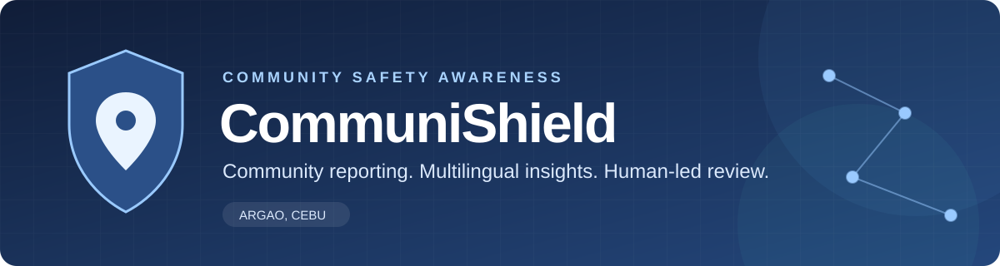
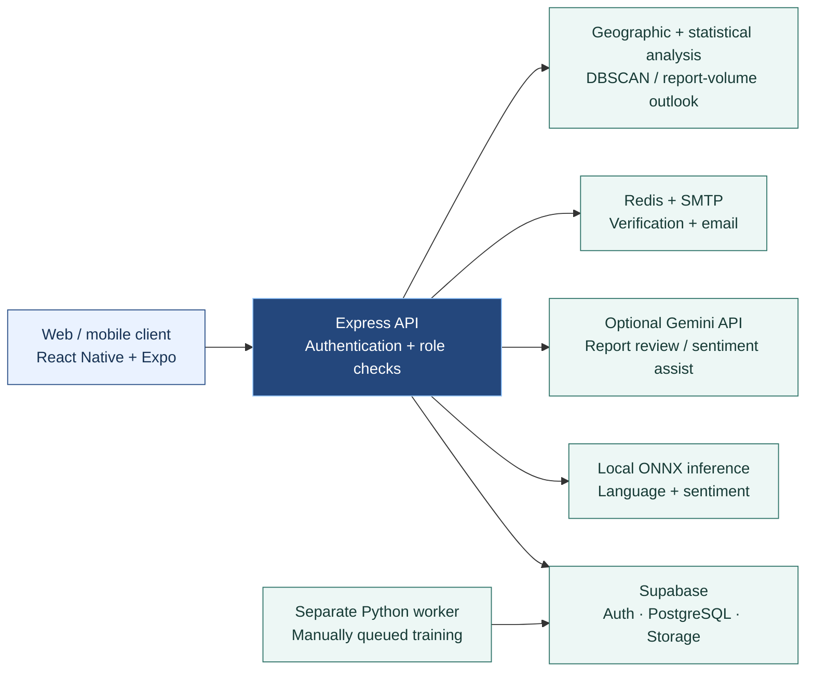
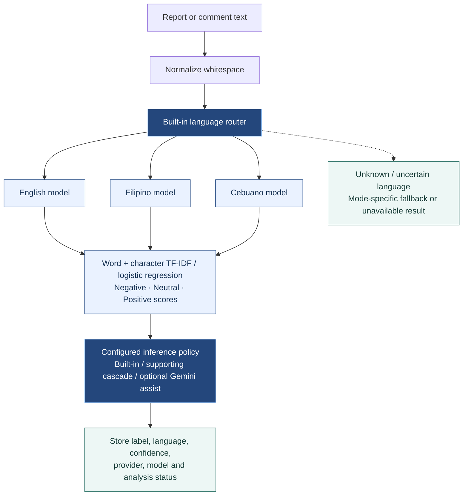
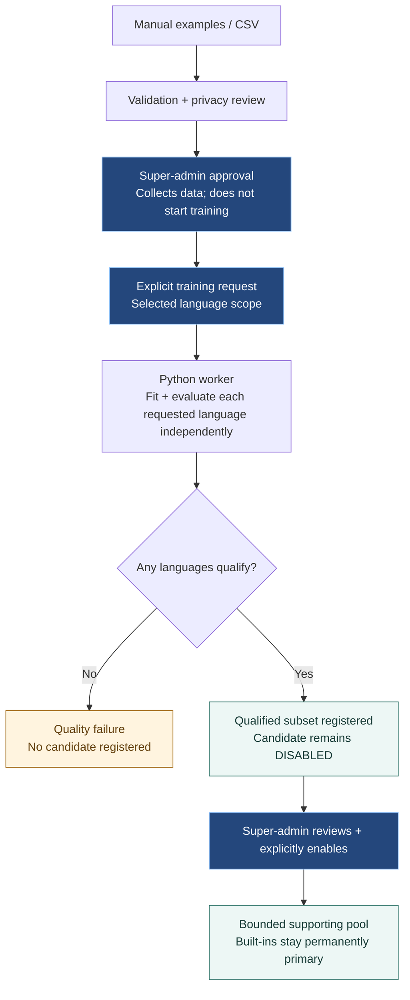

<div align="center">



# CommuniShield

**A community incident-reporting and public-safety awareness prototype for Argao, Cebu.**

<p>
  
  
  
  
  
  
</p>

**Cebuano · English · Filipino** &nbsp; | &nbsp; **Web + mobile** &nbsp; | &nbsp; **Human-reviewed reports**

<p>
  <a href="#installation">Get started</a> ·
  <a href="#features">Explore features</a> ·
  <a href="#ai-models">Understand the AI</a> ·
  <a href="tests/README.md">Test guide</a>
</p>

</div>

---

<details>
<summary><strong>Navigate this guide</strong></summary>

1. [Installation and setup](#installation)
2. [System overview](#overview)
3. [Main features](#features)
4. [Architecture and report flow](#architecture)
5. [How the AI and models work](#ai-models)
6. [Sentiment training](#training)
7. [Geographic clustering and seven-day outlook](#geography)
8. [Authentication, privacy and limits](#security)
9. [Tests and development checks](#tests)
10. [Repository guide](#repository)

</details>

<a id="installation"></a>

## 1. Installation and setup

> [!TIP]
> **Start here:** install all three npm dependency sets, configure your services,
> install the database schema, then start the backend and client. Python is optional
> unless you need training or Python tests.

### Requirements

| Requirement | Purpose |
| --- | --- |
| Node.js and npm | Run the Express backend, Expo client and JavaScript/TypeScript tests. Development has been checked with Node **24.11.1**. |
| Supabase project | PostgreSQL database, authentication and file storage. |
| SMTP email service | Password-reset emails and sign-in verification codes. |
| Upstash Redis REST credentials | Temporary verification challenges, approved sessions and password-reset state. |
| Gemini API key | Cloud AI report review and optional Gemini sentiment assistance. Not required for built-in local sentiment inference itself. |
| Python, optional | Supporting-model training, dataset maintenance and Python tests. The existing data environment uses Python **3.13.15**. |
| Browser or mobile development environment | Web testing, Expo Go where compatible, or an Android/iOS development build. Local iOS simulator builds require macOS/Xcode; Android emulator builds require Android Studio tooling. |

The commands below use **PowerShell**, starting at the repository root. The root,
backend and client have separate dependency installations; this is not an npm
workspace where one root install sets up everything.

### Install JavaScript dependencies

```powershell
npm install
npm install --prefix server
npm install --prefix clients
```

Use the repository's lockfiles for reproducible installations (`npm ci` instead
of `npm install` when the corresponding lockfile is current). Local sentiment
uses ONNX Runtime inside Node; running the app does **not** require Python, a GPU,
or a downloaded large language model.

### Configure environment files

Create missing environment files from the examples without overwriting existing
credentials:

```powershell
if (-not (Test-Path server/.env)) { Copy-Item server/.env.example server/.env }
if (-not (Test-Path clients/.env)) { Copy-Item clients/.env.example clients/.env }
```

Edit them with your own values:

| File | Configuration |
| --- | --- |
| `server/.env` | `PORT` (default `3000`), `SUPABASE_URL`, `SUPABASE_ANON_KEY`, `SUPABASE_SERVICE_ROLE_KEY`. |
| `server/.env` | `SMTP_HOST`, `SMTP_PORT`, `SMTP_USER`, `SMTP_PASS`, `EMAIL_FROM`; use your provider's SMTP credentials/app password. |
| `server/.env` | `UPSTASH_REDIS_REST_URL`, `UPSTASH_REDIS_REST_TOKEN`; optionally a strong `LOGIN_VERIFICATION_SECRET`. |
| `server/.env` | `GEMINI_API_KEY` for cloud AI. Model choice, timeouts and analysis toggles are also controlled through stored system settings. |
| `clients/.env` | `EXPO_PUBLIC_API_URL`, `EXPO_PUBLIC_SUPABASE_URL`, `EXPO_PUBLIC_SUPABASE_ANON_KEY`, as applicable to client services. |

**Never put service-role keys, SMTP passwords, Redis credentials or Gemini keys
in `EXPO_PUBLIC_*` variables.** Public client variables are bundled into the app.
Check existing `.env.local` and development-specific files for overrides, and
restart the backend/Expo process after changing configuration.

#### Important: set the actual API address

> [!IMPORTANT]
> The client currently uses a hardcoded LAN API address. Check the active Axios
> `baseURL` before troubleshooting connection errors.

`clients/services/apiClient.js` currently passes a hardcoded
`http://192.168.1.37:3000/api` to Axios; its environment-based `BASE_URL` is not
currently used. **Setting `EXPO_PUBLIC_API_URL` alone does not redirect those
requests.** Update the active Axios `baseURL` in that file for your environment:

- Same-computer web/emulator setup where reachable: `http://localhost:3000/api`.
- Android Studio emulator: normally `http://10.0.2.2:3000/api`.
- Physical phone: your computer's reachable private LAN IP, with both devices on
  the same network and the backend port allowed through the firewall.
- Hosted app: your deployed backend's HTTPS URL ending in `/api`.

`localhost` on a phone points to the phone, not your computer. Use HTTPS in
production; local HTTP testing must stay on a trusted private network.

### Set up the database

For a **new, empty Supabase project**, run these files in the Supabase SQL editor
in order:

1. `DB_Schema/finalized/01_schema.sql`
2. `DB_Schema/finalized/02_reference_data.sql`
3. `DB_Schema/finalized/03_verify.sql`

The final schema is also organized into **one file per table** under
`DB_Schema/finalized/tables/`, with shared definitions under `shared/`.
`install.psql` installs those parts with the PostgreSQL CLI. Choose the split
installer **or** the combined schema, not both.

> [!WARNING]
> **Existing database? Do not run the fresh-install schema over it.** Apply only
> missing migrations in the documented order. The verification script is read-only.

See [finalized installation instructions](DB_Schema/finalized/README.md) and the
[database file guide](DB_Schema/README.md).

The schema does not create login credentials or a default super-admin. Register
the initial account, then have the trusted database owner assign its intended
role through an authorized administrative process. Never expose role assignment
to public registration. Demo seed scripts are optional, modify database contents,
and are **not** a production setup requirement.

### Check the built-in models

The backend expects these supplied runtime artifacts under `server/models/`:

```text
language_id.onnx
sentiment_cebuano.onnx
sentiment_english.onnx
sentiment_filipino.onnx
```

An optional server-only `SENTIMENT_MODEL_DIR` can point to a trusted model
directory. Do not overwrite built-ins to install a supporting candidate, and do
not retrain models merely to start the application.

### Start the application

Backend, in one terminal:

```powershell
npm --prefix server run dev
```

Expo client, in another terminal:

```powershell
npm --prefix clients run web
```

Alternatively, use `npm --prefix clients start` for the Expo development launcher,
or `npm --prefix clients run android` / `npm --prefix clients run ios` with the
appropriate native environment. The backend normally listens on port **3000**;
Expo prints its web/development URL. The backend root `/` responds with
`It is working` when reachable.

Sign-in needs working SMTP and Redis, not just a database connection. The first
login from an unrecognized device requires an email verification code.

<details>
<summary><strong>Optional setup: Python dependencies and the training worker</strong></summary>

### Optional: install Python training dependencies

Only do this if you need dataset tools, Python tests or the training worker:

```powershell
python -m venv .venv-data
.\.venv-data\Scripts\python.exe -m pip install --upgrade pip
.\.venv-data\Scripts\python.exe -m pip install -r datasets/requirements-training.txt
```

The worker also needs the trusted baseline splits, matching training state for
continued training, and the current database protocol. Local `datasets/raw/`,
`processed/`, `models/` and `training-runs/` contents may be Git-ignored and are
not guaranteed to exist in a fresh clone. Dependency installation alone does not
reconstruct that data. Obtain the approved assets; do not substitute held-out
test data or unreviewed generated labels.

After installing the complete training schema and preparing those inputs:

```powershell
.\.venv-data\Scripts\python.exe datasets/sentiment_training_worker.py --env-file server/.env
```

Monitor from a separate terminal:

```powershell
.\.venv-data\Scripts\python.exe datasets/worker_progress.py --env-file server/.env --watch
```

The worker is a separate long-running process; starting Express does not start
it. Starting the worker does not approve data, manually queue a run, or enable a
candidate. See [language-scoped training](server/SENTIMENT_LANGUAGE_SCOPED_TRAINING.md).

</details>

---

<a id="overview"></a>

## 2. What is CommuniShield?

CommuniShield is a cross-platform community incident-reporting and public-safety
awareness system focused on **Argao, Cebu**. Residents can submit reports, attach
photos, discuss updates and view mapped community information. Administrators
review submissions, manage incident records and inspect descriptive analytics.
Super-admins additionally manage privileged accounts, system configuration and
the reviewed sentiment-training workflow.

The system combines human moderation with multilingual text classification,
cloud-assisted report review, geographic clustering and statistical reporting
outlooks. These components answer **different questions**; they do not combine
into a scientifically validated danger score.

> [!CAUTION]
> CommuniShield is a prototype decision-support system, not an emergency dispatch
> service, a verified crime database, or a guarantee that an area is safe. For an
> emergency, contact the appropriate emergency service directly.

<a id="features"></a>

## 3. Main features

| Residents | Administrators | Super-admins |
| :--- | :--- | :--- |
| **Report & participate** — submit incidents, attach photos and discuss updates. | **Review & manage** — moderate reports, inspect maps and track report history. | **Govern & configure** — manage privileged accounts, settings and reviewed training. |
| **Stay informed** — explore nearby reports, notifications and safety tips. | **Understand patterns** — inspect analytics, spatial concentrations and submission outlooks. | **Control candidates** — approve data, queue training and manually enable qualified supports. |

### Resident features

- Account registration, password recovery and email/device sign-in verification.
- Incident submission with category, type, narrative, location and photo uploads.
- Personal report tracking and permitted report editing.
- Community feed, report discussions/comments and likes.
- Interactive incident map with Argao barangay boundaries and location hierarchy.
- Notifications, nearby-report safety tips and emergency-facility information.
- Profile settings and separate notification/crime-alert preferences.

### Administrative features

- Dashboard and incident/category analytics.
- Review, verify, reject, resolve and manage reports through authorized actions.
- Report management with filtering, export and archived-report access through logs.
- Incident mapping and DBSCAN hotspot detection with sentiment/verification context.
- Current report-concentration indicators and a separate seven-day submission outlook.
- Announcements, administrative notifications, audit history and settings.
- Super-admin account management and sentiment dataset/candidate lifecycle controls.

Permissions are enforced by backend role checks and database policies, not only
by hiding buttons. Dataset inspection/submission and super-admin approval,
training and enabling are separate operations.

---

<a id="architecture"></a>

## 4. Architecture and report flow



| Layer | Implementation |
| --- | --- |
| Client | React Native, Expo, Expo Router, web/native map components and Axios. |
| API | Node.js, Express and TypeScript; local entry point `server/app.ts`, hosted API entry `server/api/index.ts`. |
| Persistence | Supabase PostgreSQL, Auth and Storage. |
| Verification/email | Upstash Redis REST and SMTP via Nodemailer. |
| Local model inference | ONNX Runtime in the backend. |
| Cloud AI | Gemini API, where configured and enabled. |
| Offline training | Python, scikit-learn, pandas, NumPy, joblib and ONNX export tools. |

Typical report flow:

1. The authenticated user completes a report and uploads any photos.
2. The API validates and persists the report and photo links before acknowledging
   success. A failed write must not appear as a successful submission.
3. Tracked background work handles submission credibility points, notifications,
   AI-assisted report review and sentiment analysis. Independent work is not
   blocked by one failed AI component.
4. The client can display the saved report while analysis is still pending.
5. Administrators inspect the report, available analysis and subsequent updates,
   then take an authorized moderation action.

Saving a report is **not** proof that AI analysis succeeded or that its contents
are verified. Analysis failures and insufficient-data states must remain visible.

<a id="ai-models"></a>

## 5. How the AI and models work

| Component | Question it addresses | What it does **not** establish |
| :--- | :--- | :--- |
| **Sentiment** | What tone does the text express? | Whether the report is true or dangerous. |
| **AI-assisted review** | What details and potential severity deserve review? | Verified facts or a final moderation decision. |
| **DBSCAN** | Where are eligible active report locations concentrated? | A future crime event or danger probability. |
| **Seven-day outlook** | How many reports might be submitted? | Actual crime rates or individual safety. |

### A. Language identification and built-in sentiment

The built-in language router identifies **Cebuano, English or Filipino**. It uses
a trained word/character TF-IDF and logistic-regression pipeline exported to
`language_id.onnx`. Blank, uncertain or failed routing can return `unknown`.

For a supported language, its corresponding built-in sentiment model processes
the text:



TF-IDF represents informative words and character sequences numerically;
logistic regression learns associations with reviewed sentiment labels. These
are lightweight classifiers, not conversational LLMs. ONNX packages the pipeline
for inference without a Python service.

The wider service also supports `mixed` and `unclear` outcomes through cloud
analysis or abstention. A three-class local classifier does not independently
learn a fourth `mixed` class. Short words, sarcasm, negation and code-switching
can be difficult; confidence is a model score, **not a calibrated guarantee of
correctness**.

The built-in models and language router remain permanently primary. Uploaded
examples, candidate training and candidate enabling do not overwrite them.

### B. Optional supporting sentiment candidates

Supporting candidates are separately trained and independently evaluated helpers.
When supporting inference is configured, the primary model runs first:

- A confident primary prediction stays with the built-in.
- Only enabled, verified candidates qualified for the matching language may
  contribute in the primary's uncertainty region.
- Candidates must meet their recorded acceptance thresholds.
- Qualified disagreement between supports, or between an independent support and
  the primary label, returns **`unclear`**. There is **no majority voting**.
- If eligible supports cannot produce a reliable accepted proposal, the routing
  policy can also abstain rather than manufacture certainty.

The enabled pool is bounded to **1–3 candidate bundles**. Candidates have manual
enable/disable/archive/restore/delete controls, subject to permissions and
history-preservation rules. Artifact manifests, checksums, built-in fingerprints
and protocol checks protect model loading and publication.

Supporting inference requires both backend flags:

```dotenv
SENTIMENT_MODEL_REGISTRY_ENABLED=true
SENTIMENT_SUPPORT_ENABLED=true
```

Set them only after the complete current schema/protocol is installed. They do
not train, qualify or enable candidates by themselves. With no qualified enabled
candidates, the built-in remains available.

### C. Optional Gemini sentiment assistance

Outside supporting-pool mode, settings can enable Gemini sentiment assistance.
The prompt classifies tone, allows `mixed`/`unclear`, and can include a parent
report's context for a comment. It explicitly separates sentiment from severity
and credibility.

Where local and Gemini predictions are both available, a separate assist policy
handles agreement and disagreement. Agreement averages their confidence scores;
disagreement retains sufficiently confident local output or uses Gemini to
rescue weak local output, with confidence reductions. Very short inputs require
stronger local confidence. Local output can survive a failed cloud request.

This is **not** the supporting-candidate voting policy. In supporting-pool mode,
Gemini sentiment assistance is suppressed so it cannot override protected
primary/cascade decisions. Local-only reanalysis can also explicitly bypass cloud
sentiment. Unknown-language fallback behavior depends on the selected mode; it
must not be presented as guaranteed multilingual understanding.

### D. Gemini-assisted report review and severity

Report review is a separate service from sentiment. It sends incident details,
location and available contextual counts to Gemini and requests structured JSON:

- An AI report-assessment score from 0 to 100.
- A proposed severity: `Low`, `Medium`, `High` or `Critical`.
- A written explanation specific to the report.

The service loads configured model settings, can discover available model names,
and handles model failures/rate limits. No particular Gemini version is guaranteed
to be available for every API account. Successful analyses retain the model
version and analysis timing.

The pipeline also attempts image-metadata checks for missing metadata,
location/time inconsistencies and editing indicators; flags can reduce the
assessment score. **Metadata heuristics do not authenticate a photo or prove a
report false.** Missing metadata can have innocent causes, and these checks are
not a forensic computer-vision model.

AI review is advisory: it does not establish that an event happened, identify an
offender, or replace administrator verification. Cloud outages must not be
reported as successful analysis.

### E. User credibility is separate

User credibility is an application-managed, bounded points system, not a trained
AI model. Submission and moderation events can add or subtract points, with an
event history. It is distinct from a report's Gemini assessment score, its
severity, and the emotional tone of its text. None is a substitute for evidence.

---

<a id="training"></a>

## 6. How sentiment training works



CSV uploads use `text,language,label`. Languages are `cebuano`, `english` and
`filipino`; training labels are `negative`, `neutral` and `positive`. One-row and
single-word submissions are allowed, but low-context examples need careful human
review, not automatic labels.

Any one language, any pair, or all three can be requested. Scope comes from
declared reviewed row languages, **not automatic language detection**. Dataset
checkboxes select the run's language scope, not model activation or an exclusive
training corpus. Within those languages, baseline training rows and prior approved
examples remain available. Without selection, new approved versions determine
scope; a deliberate retry without new approvals retains the last recorded scope.

Two fitting modes are available:

- **Continued/warm-start:** reuse trusted existing weights and fixed vocabulary,
  adding approved examples with replay data.
- **Fresh challenger:** learn vocabulary and weights from baseline training data
  plus approved additions for the requested languages.

Each requested language is fitted/evaluated independently. An ordinary quality
failure in Filipino, for example, does not discard a passing Cebuano candidate.
Failed languages have no serving artifacts/policy; unrequested languages are
shown as **Not included**. Unexpected crashes, stale worker leases and invalid
artifacts still fail closed.

Current independent qualification gates include:

| Check, per language | Minimum |
| --- | --- |
| Validation and test macro-F1 | 0.60 |
| Every class's precision and recall on both splits | 0.50 |
| Held-out examples per class on each split | 10 |
| Accepted validation predictions | 20 |
| Accepted test predictions | 10 |
| Precision among accepted predictions on both splits | 0.75 |

Validation acceptance-threshold selection additionally requires a **Wilson 95%
lower precision bound of at least 0.75**. Test requirements are not weakened to
rescue a candidate. Qualification is independent: a candidate need not outperform
the built-in, but it must pass the absolute quality gates.

Approval does not start training; qualification does not automatically enable a
model. A small upload can accumulate toward later training and is **not** a
promise that the next run will pass. Human label quality and honest held-out
evaluation matter more than merely increasing row counts. Keep test material out
of uploads and do not repeatedly tune against final test outcomes.

See the [training workflow](server/SENTIMENT_LANGUAGE_SCOPED_TRAINING.md),
[admission rules](server/SENTIMENT_INDEPENDENT_ADMISSION.md), and
[training audit](datasets/SUPPORTING_TRAINING_AUDIT.md).

<a id="geography"></a>

## 7. Geographic clustering and the seven-day outlook

### Hotspot detection: observed spatial concentrations

The backend runs **DBSCAN** on eligible active report locations within the bundled
Argao boundaries. Defaults are a trailing **30-day** window, a **300-metre**
neighborhood and **4 distinct locations** for density support, including the
location itself. Date/category/type filters apply before clustering.

Identical coordinate pairs count as **one spatial location**, while retaining
their original report IDs/counts. Repeated posts at a single pin cannot create a
cluster by themselves. Invalid/out-of-boundary locations and excluded report
statuses do not create density. Barangay assignment prioritizes coordinates over
street-name assumptions.

Cluster summaries can display stored multilingual sentiment and verification
context. Missing/failed analyses are not silently counted as neutral. Comments
are balanced across reports so one busy discussion cannot dominate the summary.
Sentiment does **not** change DBSCAN memberships or become a danger probability.
Heatmap colors are a visual aid, not an independent predictive model.

### Seven-day outlook: submitted-report volume, not crime probability

The outlook is a **statistical estimate of future report submissions**, separate
from current active-report concentrations. It uses eligible historical reports,
including resolved reports, while excluding archived/rejected/marked-fake rows,
invalid locations, future dates and the current incomplete UTC day.

It compares a recent-mean baseline with an eight-week weighted weekday profile.
Earlier chronological backtests select the weekday method only when it improves
weekly mean absolute error; ties retain the simpler baseline. The target is the
next **seven full UTC days starting tomorrow**, not the remainder of today.

The provisional sufficiency gate requires at least **112 complete days** of
history, **20 distinct reports** across **10 reporting days**, and some activity
in the last **28 complete days**. Short, sparse, stale or incomplete history can
produce **Insufficient data** instead of a fabricated forecast.

Displayed historical-error ranges are descriptive, **not calibrated confidence
intervals**. Neither Gemini nor negative sentiment generates the forecast counts.
The forecast does not estimate actual crime rates, an individual's risk, patrol
requirements or the probability of a particular incident.

Read [hotspot implementation](server/HOTSPOT_CLUSTERING.md) and the
[current outlook policy](server/RISK_OUTLOOK.md) for exclusions and limitations.

---

<a id="security"></a>

## 8. Authentication, privacy and operational limits

> [!IMPORTANT]
> **Sentiment is not danger. AI review is not verification.** Protect personal
> information, review storage visibility, and keep human moderation in the loop.

- Sign-in uses Supabase credentials plus app-level email/device verification.
  Unrecognized devices receive a six-digit code; codes expire after 10 minutes,
  allow five incorrect attempts and have resend limits. Remembered-device trust
  lasts up to 30 days. This is not Supabase authenticator MFA/AAL2.
- Redis-backed API session approval prevents a password-only Supabase token from
  bypassing the API's device-verification requirement. Database RLS must still
  independently protect direct database access.
- Roles, account status, moderation actions and training lifecycle operations
  require appropriate authorization. Keep privileged backend keys server-only.
- With cloud AI enabled, relevant report text/context is sent to an external AI
  provider. Obtain the required consent and review provider/data-retention terms.
- Report photos currently use the **public `report-images` storage bucket**;
  possession of a photo URL can allow access. Do not assume authenticated UI
  access makes stored photos private. Review this before handling sensitive data.
- Training artifacts use a separate **private `sentiment-models` bucket**.
  Training submissions need privacy review; remove personal information first.
- Notifications depend on saved preferences, device/location availability and
  email/push delivery. They are not guaranteed real-time emergency alerts.
- Current evaluation includes synthetic scenarios and has dataset/label-quality
  limitations. Passing software tests or model gates does not demonstrate
  real-world safety effectiveness. A supporting pass also does not prove the
  combined inference system is better.

See [email sign-in verification](server/LOGIN_VERIFICATION.md) for security details.

<a id="tests"></a>

## 9. Tests and development checks

All automated suites live under one root [`tests/`](tests/README.md) folder:

```text
tests/
  server/       Backend TypeScript unit/integration tests
  clients/      Client helper and source regression tests
  datasets/     Python dataset/training-tool tests
  database/     Isolated PostgreSQL schema/migration tests
  browser/      Exported-web browser tests with mocked APIs
  helpers/      Shared test-only setup
```

From the repository root:

```powershell
npm test
npm run test:types
npm --prefix server run build
npm --prefix clients run build:web
.\.venv-data\Scripts\python.exe -m unittest discover -s tests -t .
```

`npm test` runs backend and client tests. Database and browser suites are opt-in:

```powershell
npm run test:database
npm run test:browser
```

They require PGlite or Playwright/browser/export configuration described in
`tests/README.md`. Isolated database tests do not connect to live Supabase, and
browser fixtures do not establish real-world model accuracy. Do not run demo
seed scripts as though they were read-only tests.

<a id="repository"></a>

## 10. Repository guide

| Path | Contents |
| --- | --- |
| `clients/` | Expo app, role-based screens, UI components, maps and API services. |
| `server/src/` | Controllers, services, authorization, routes and model inference. |
| `server/models/` | Permanent built-in ONNX runtime artifacts. |
| `server/scripts/` | Offline evaluations, maintenance and optional synthetic-data tools. |
| `datasets/` | Python training/worker code, dataset audits and local training assets. |
| `DB_Schema/finalized/` | Final schema, per-table SQL, reference defaults and verification. |
| `DB_Schema/migrations/` | Incremental upgrades for existing databases. |
| `tests/` | Centralized automated suites and test instructions. |

For deployment, configure backend/client environments separately, use HTTPS,
check authentication and storage permissions, and keep the Python worker outside
short-lived HTTP/serverless requests. Deploying code does not automatically apply
SQL migrations, copy ignored training assets, train candidates or enable models.

---

<p align="center">
  <strong>Community reporting · Transparent model behavior · Human-led decisions</strong><br/>
  <a href="#installation">Back to setup</a> ·
  <a href="DB_Schema/finalized/README.md">Database guide</a> ·
  <a href="tests/README.md">Test guide</a>
</p>
